# My Raspberry Pi 4B+ Model

This is my introduction to setting up a smol home lab, with self hosted solutions developed by the open source community.

I have tried to keep the **configurations and important files under `home/`** as they should be present on a real linux.

You can still not connect to my network because it **uses a [zerotier](https://www.zerotier.com/) service** and my auth. However, you can setup your own and take inspiration from the `home/docker-compose.yml` file.

Here are some screenshots:  

Dashboard with [Dashy](https://dashy.to/):  
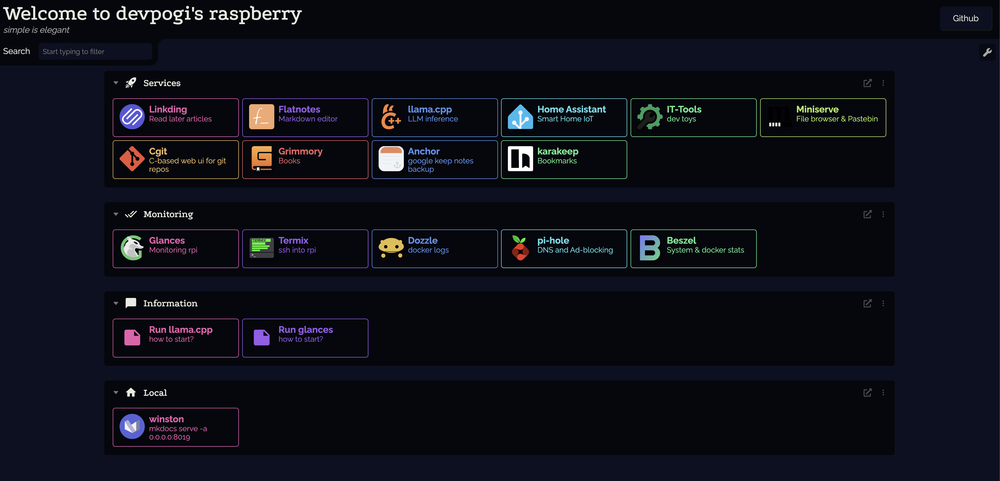

Read it later service [Linkding](https://linkding.link/). I use it together with [Pinkit android](https://github.com/fibelatti/pinboard-kotlin) and [linkding chrome extension](https://github.com/jeroenpardon/linkding-extension):  
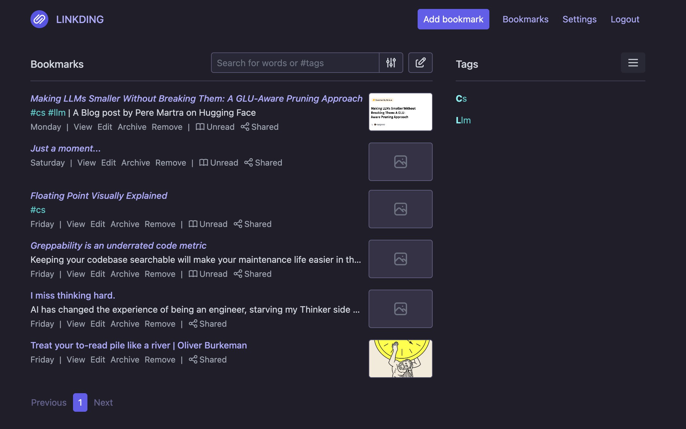

Terminal access with system stats, file managment, docker management by [termix](https://github.com/Termix-SSH/Termix):  
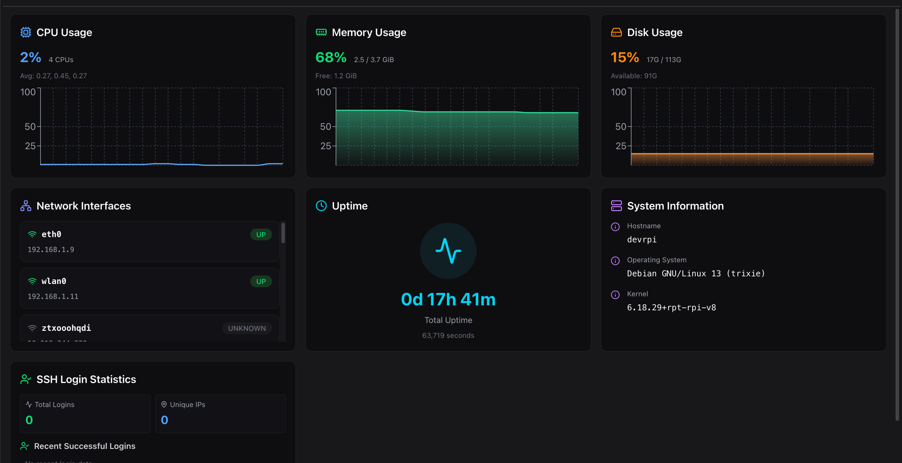

Quick Notes, simple markdown based, no clutter [Frankmd](https://github.com/akitaonrails/frankmd)  
> Used earlier: [flatnotes](https://github.com/dullage/flatnotes)  

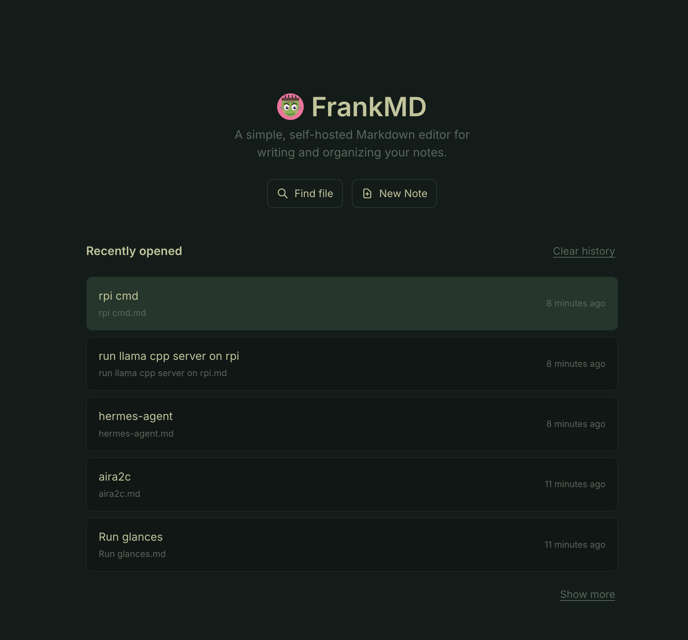

IoT integrations with [Home Assistant](https://www.home-assistant.io/installation/raspberrypi-other):  
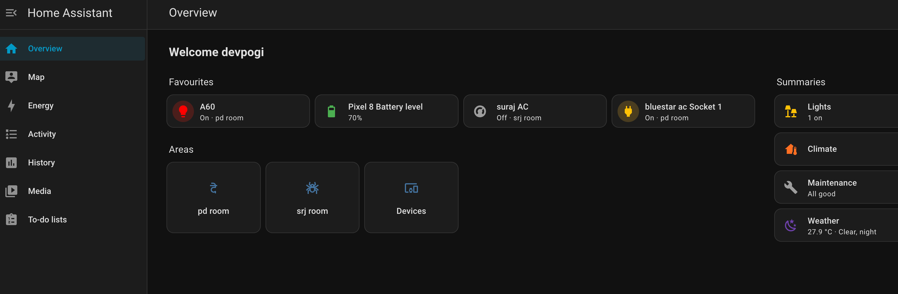

AI inferencing using [llama.cpp](https://github.com/ggml-org/llama.cpp/tree/master/tools/server):  
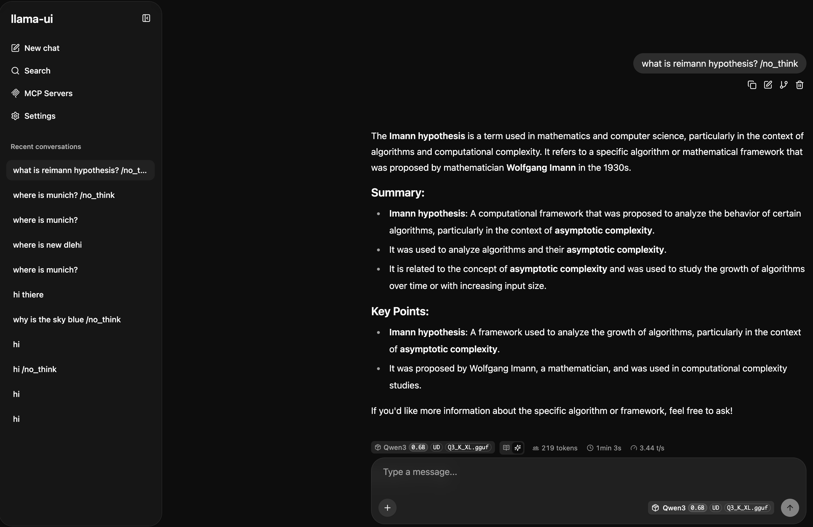

`top` but more detailed system stats, using [glances](https://github.com/nicolargo/glances):  
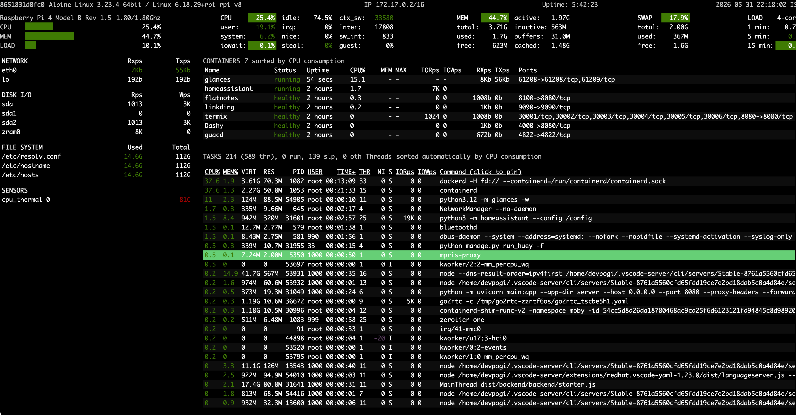

Dev tools using [IT-Tools](https://github.com/CorentinTh/it-tools):  
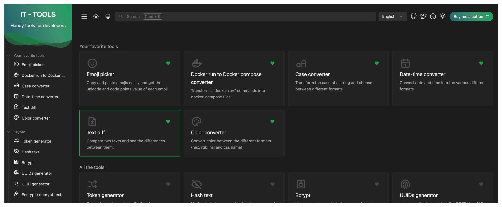

Simple HTTP based file browser and pastebin using [Miniserve](https://github.com/svenstaro/miniserve):  
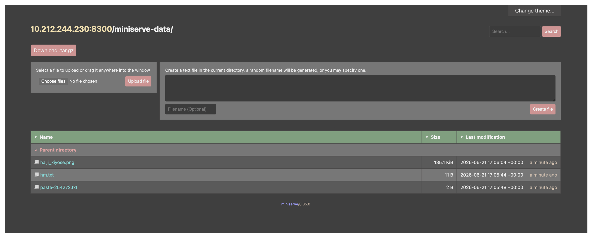

Git web interface viewer using [cgit](https://github.com/joseluisq/alpine-cgit):  
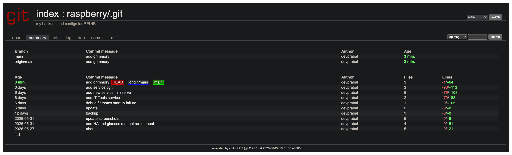

E-books management using [bookorbit](https://github.com/bookorbit/bookorbit). I use it together with Android app [readest](https://github.com/readest/readest):  
> Previously used: [Grimmory](https://github.com/grimmory-tools/grimmory)  

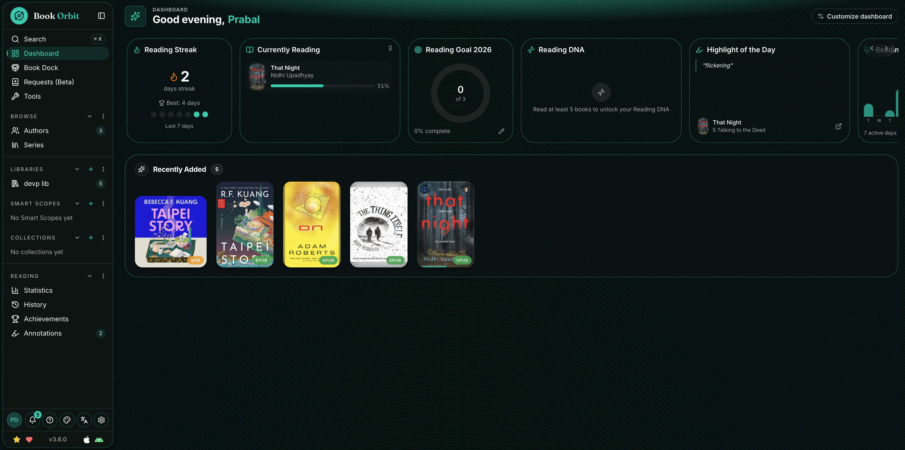

Audiobook management using [audiobookshelf](https://github.com/advplyr/audiobookshelf). I use it together with its android apps [audiobookshelf android official app](https://github.com/advplyr/audiobookshelf-app) and [readest](https://github.com/readest/readest):  
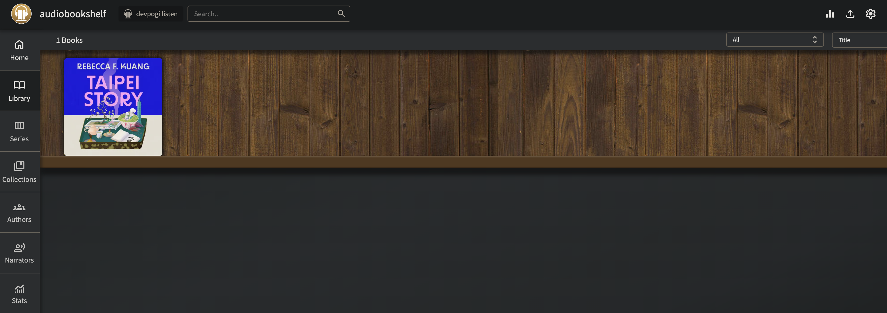

RPI and docker:  
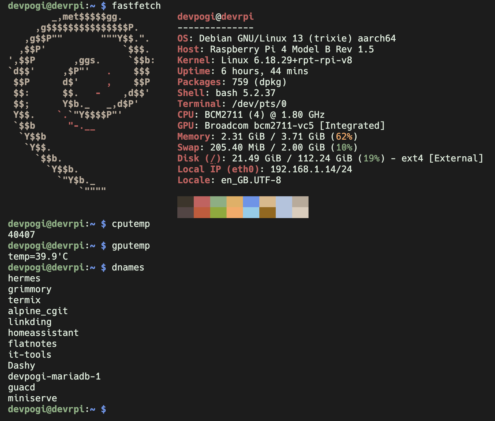  

[Anchor](https://github.com/ZhFahim/anchor) for backing up google keep notes:  
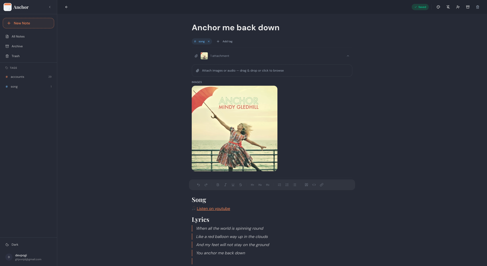

Docker logs on web using [Dozzle](https://github.com/amir20/dozzle):
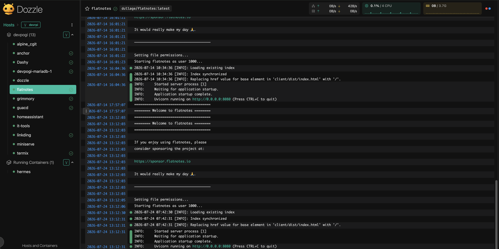

DNS and Ad blocking using [pi-hole](https://github.com/pi-hole/docker-pi-hole) with the [huge blocklist](https://firebog.net/):  

Links bookmarks using [Karakeep](https://github.com/karakeep-app/karakeep/). I use it together with [karakeep android app](https://play.google.com/store/apps/details?id=app.hoarder.hoardermobile&pcampaignid=web_share) and [karakeep chrome extension](https://chromewebstore.google.com/detail/karakeep/kgcjekpmcjjogibpjebkhaanilehneje):  
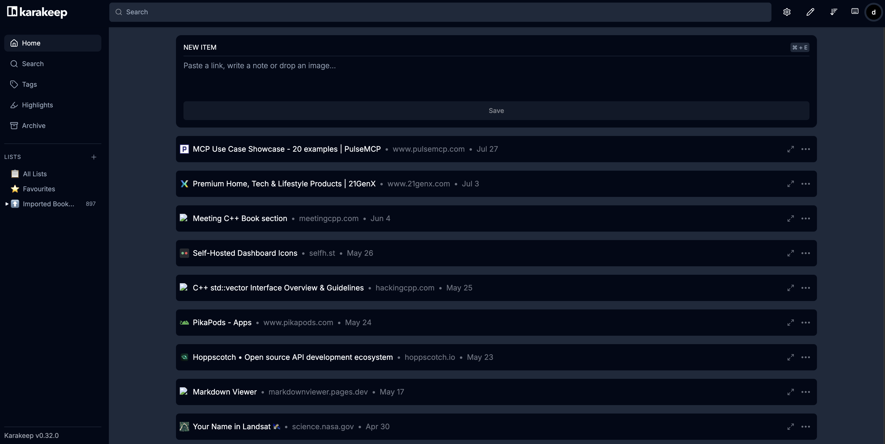

Trying to move away from karakeep using another "Save for Later Reading" app [readeck](https://codeberg.org/readeck/readeck) which is lighter, unclutter, not many features (yet basic and necessary ones present).  
I use it together with its unofficial android app [Readeck App](https://github.com/jensomato/ReadeckApp) because the official android app can't authenticate with my self hosted instance.  
I use it also with [official chrome extention](https://chromewebstore.google.com/detail/readeck/jnmcpmfimecibicbojhopfkcbmkafhee).    
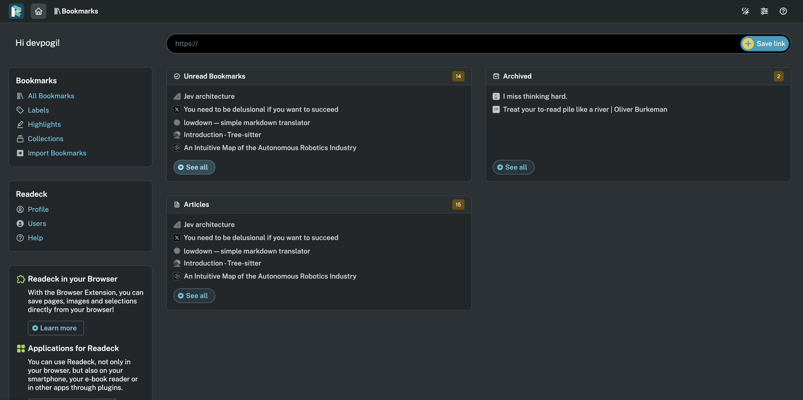  

Docker stats and system stats using [Beszel](https://github.com/henrygd/beszel):  
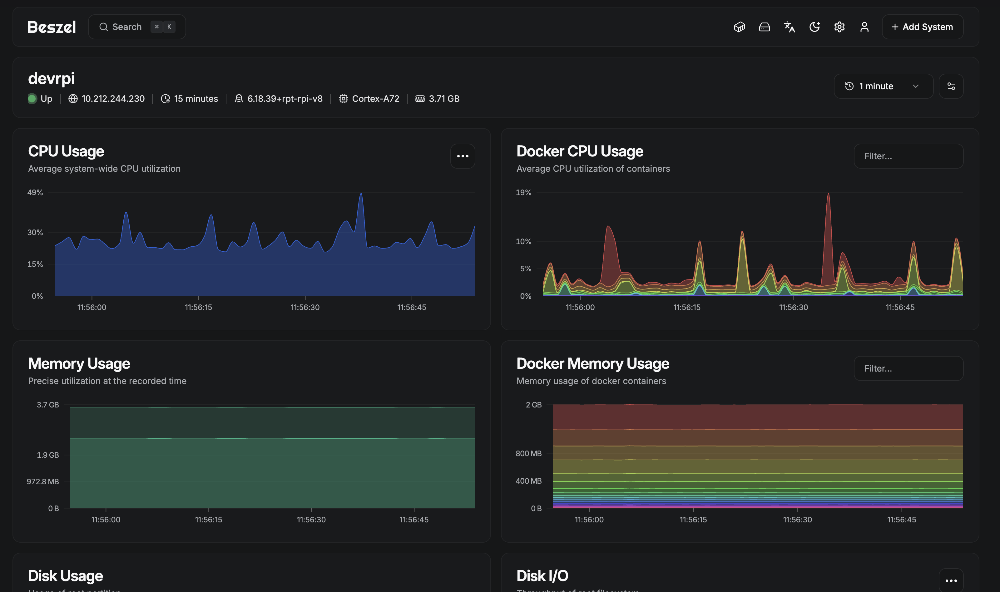

