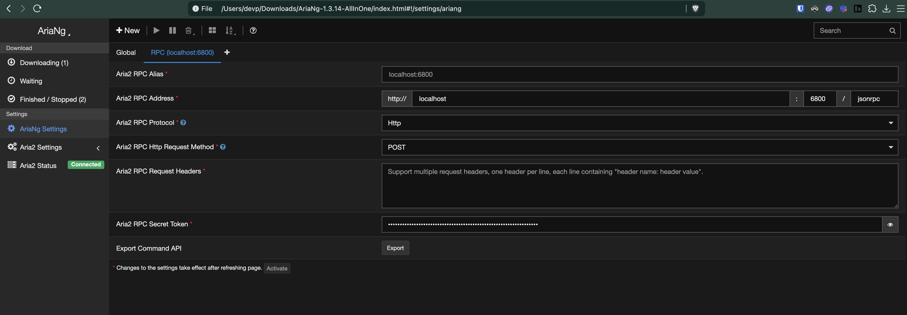

# Run aria2c to listen on a port

```bash
aria2c --conf-path=/Users/devp/.aria2/aria2.conf
```

# conf file

```txt
dir=/Users/devp/Downloads/aria2
enable-rpc=true
rpc-listen-all=true
rpc-listen-port=6800
rpc-secret=xxxxxxxxxxxxxxxxxxxxxxxxx
continue=true
max-connection-per-server=16
split=16
min-split-size=1M
input-file=/Users/devp/.aria2/aria2.session
save-session=/Users/devp/.aria2/aria2.session
save-session-interval=60
daemon=true
rpc-allow-origin-all=true
```

# session file

Create an empty `aria2.session` file at `~/.aria2`.

# check aira2 is running or not

```bash
ps aux | head -1; ps aux | grep aria2c
```

# check port

```bash
nc -zv localhost 6800

lsof -i :6800
```

# kill / stop

```bash
pkill aria2c
```

# download with Aria2Ng (web ui)

Launch `index.html` from the downloaded `AriaNg-1.3.14-AllInOne` folder. No need to launch it on a server. Just double click the file. It is a client side js.

# web ui settings



You can use random number to generate the token.

```bash
openssl rand -hex 32
```

# download from command line

```bash
aria2c -x 16 -s 16 -c -d ~/Downloads -o filename.zip "https://example.com/file.zip"
```

-x = max connections per server (max 16)
-s = number of splits for the file

# Resume a partial/interrupted download

```bash
aria2c -c "https://example.com/file.zip"
```